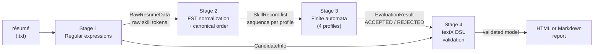

# ResumeLens: Formal Language-Based Resume Screening

Integrative project of **Computación y Estructuras Discretas III (2026-2)**, Universidad Icesi.
Professor: Andrés Aristizábal.

**Members:** Juan Restrepo, Samuel Granda, Daniel Varela.

ResumeLens reads a plain-text résumé and decides, for four professional profiles, whether the
qualifications that appear **explicitly** in the text satisfy a formally defined qualification
pattern. It does **not** rank candidates and it does not make hiring decisions.

Each stage of the pipeline is built on one of the formal models studied in the course:

| Stage | Task | Formal model | Tool |
|---|---|---|---|
| 1. Extraction | Find contact data, education, experience and skills in the text | Regular expressions | Python `re` |
| 2. Normalization | Turn equivalent spellings (`JS`, `Javascript`) into one canonical name | Finite-state transducers, M = (Q, Σ, Γ, δ, ω, q0, F) | `pyformlang.fst.FST` |
| 3. Classification | Accept or reject the canonical skill sequence for each profile | Finite automata, M = (Q, Σ, δ, q0, F) | `pyformlang.finite_automaton` |
| 4. Candidate language | Represent, validate and visualize the result | Context-free grammar, G = (V, Σ, S, P) | `textX` |

## Pipeline



Example of the normalization and ordering (taken from the assignment):

```
Git, NodeJS, JS, Postgres, React.js   ->   JAVASCRIPT, REACT, NODE_JS, POSTGRESQL, GIT
```

The four profiles go through the **same** code. Only the data change: the transducer tables, the
canonical order and the automaton of each profile.

## Supported profiles

Each profile is a deterministic finite automaton (DFA) over the canonical skill names, read stage
by stage. A stage groups equivalent technologies (for example, *Pandas* or *NumPy*); optional stages
may be skipped. Known skills that do not belong to the profile are tolerated only **after** the
profile part; if one appears before a required stage is satisfied, the sequence is rejected.

| Profile | Stages (in order) |
|---|---|
| **Full Stack Developer** | web language → frontend framework → backend framework → database → *API (optional)* → version control |
| **Machine Learning Engineer** | base language → data library → ML framework → *ML practice (optional)* → database → version control |
| **DevOps Engineer** | language → container → orchestration → infrastructure as code → *CI/CD (optional)* → *cloud (optional)* → version control |
| **Data Engineer** | language → data processing → workflow → database → *cloud (optional)* → version control |

Full Stack Developer and Machine Learning Engineer are the two reference profiles of the
assignment. DevOps Engineer (software engineering) and Data Engineer (AI/data) are the two
profiles defined by this team. The exact definitions, with the 5-tuple of every automaton, are in
[`docs/formalization.md`](docs/formalization.md).

## Repository structure

```
ResumeLens/
├── main.py                       # entry point of the command line
├── requirements.txt
├── data/
│   ├── input_resumes/            # synthetic résumés (4 profiles + 1 invalid)
│   └── templates/report_template.html
├── docs/                         # design and formalization documents (Markdown)
├── resumelens/
│   ├── core/                     # domain models and file reader
│   ├── extraction/               # Stage 1: patterns.py, extractor.py
│   ├── normalization/            # Stage 2: transducers.py, normalizer.py, sorter.py
│   ├── classification/           # Stage 3: automata.py, classifier.py
│   ├── grammar/                  # Stage 4: resume_grammar.tx, parser.py
│   ├── visualization/            # Stage 4: renderer.py (HTML and Markdown)
│   └── cli.py                    # orchestration of the four stages
└── tests/                        # pytest suite
```

| Module | Main public functions |
|---|---|
| `core.reader` | `read_resume_file(path)` |
| `core.models` | `CandidateInfo`, `RawResumeData`, `SkillRecord`, `EvaluationResult` |
| `extraction` | `extract_resume(text)`, `extract_contact`, `extract_education`, `extract_experience`, `extract_skills`; compiled patterns in `patterns.PATTERNS` |
| `normalization` | `normalize_with_report(raw_skills)`, `sort_by_profile(records, profile)`; transducers built with `build_transducer` |
| `classification` | `classify_all(records)`, `classify_records`, `accepts`, `build_automaton` |
| `grammar` | `build_profile_source(...)`, `parse_candidate_profile(source)`, `is_valid_profile_source`, `load_metamodel` |
| `visualization` | `render_html(model)`, `render_markdown_report(model)`, `write_visualization(content, path)` |
| `cli` | `run_pipeline(cv_path)`, `main(argv)` |

The input and output contracts of every function are described in
[`docs/module_design.md`](docs/module_design.md).

## Installation

Requires Python 3 (the project was run and tested with Python 3.12).

```bash
python -m venv .venv
# Windows (PowerShell): .venv\Scripts\Activate.ps1
# Linux/macOS:          source .venv/bin/activate
pip install -r requirements.txt
```

Dependencies (`requirements.txt`): `pyformlang`, `textx`, `pytest`, `pydot`. No other library is
used: there are no NLP/machine-learning packages, no other parser generators, no graph libraries,
no databases and no network calls.

## Usage (command line)

```bash
python main.py --cv <resume.txt> [--profile NAME] [--output FILE]
```

| Option | Meaning |
|---|---|
| `--cv` (required) | Path of the plain-text (UTF-8) résumé |
| `--output` | Report to write. The extension selects the format: `.html`/`.htm` for HTML, `.md`/`.markdown` for Markdown |
| `--profile` | Show only this profile in the console report. Accepts `FULL_STACK_DEVELOPER`, `MACHINE_LEARNING_ENGINEER`, `DEVOPS_ENGINEER`, `DATA_ENGINEER`, or names such as `"Data Engineer"` |

Without `--output` the four stages run and the report is printed in the console only.

Examples with the synthetic résumés included in the repository:

```bash
python main.py --cv data/input_resumes/resume_fullstack.txt
python main.py --cv data/input_resumes/resume_ml.txt --output reports/ml.html
python main.py --cv data/input_resumes/resume_data.txt --profile "Data Engineer" --output report.md
```

Console output of the second kind of run (shortened):

```
[Stage 1] Extraction (regular expressions)
  Name        : Mary Jane Watson
  Raw skills  : Python, Pandas, NumPy, Scikit-learn, TensorFlow, SQL, Git

[Stage 2] Normalization (finite-state transducers)
  Python       -> PYTHON        (language)
  Scikit-learn -> SCIKIT_LEARN  (ml_framework)
  ...
  Canonical order by profile:
    MACHINE_LEARNING_ENGINEER: PYTHON, NUMPY, PANDAS, SCIKIT_LEARN, TENSORFLOW, SQL, GIT

[Stage 3] Classification (finite automata)
  Machine Learning Engineer  ACCEPTED  matched: PYTHON, NUMPY, PANDAS, ...

[Stage 4] Candidate language (textX) and report
  DSL document : valid (49 lines)
  Report       : written to reports/ml.html

Final verdict
  ACCEPTED : Machine Learning Engineer
  REJECTED : (none)
```

**Exit status:** `0` when the four stages finish and the requested report is written; `1` when the
résumé cannot be read, when the candidate document is not valid for the grammar (for example, a
résumé without recognized skills, such as `resume_invalid.txt`) or when the report cannot be
written; `2` for invalid command-line arguments.

## Candidate profile language (Stage 4)

The result of the previous stages is written in a small language defined by a context-free grammar
in [`resumelens/grammar/resume_grammar.tx`](resumelens/grammar/resume_grammar.tx). A document has
five blocks, always in this order, and always the four profile verdicts:

```
candidate {
    personal   { name: "WEDNESDAY ADDAMS"  email: ...  phone: ...  link: https://... }
    education  { study "B.S. in Computer Science" }
    experience { job "Full Stack Developer, Raven Labs (2023 - 2026)" }
    skills     { skill JAVASCRIPT category web_language raw "JS"  ... }
    evaluation {
        profile FULL_STACK_DEVELOPER: ACCEPTED
            matched [JAVASCRIPT, REACT, NODE_JS, POSTGRESQL, GIT]
            details "ACCEPTED - Full Stack Developer ..."
        ...
    }
}
```

A document that breaks a lexical or syntactic rule is rejected with `TextXSyntaxError`, and no
report is generated. The EBNF specification, the terminals and non-terminals and the derivations
are in section 4 of [`docs/formalization.md`](docs/formalization.md).

## Tests

```bash
pytest
```

The suite has about 1,700 tests and covers every stage and the complete pipeline:

| File | Covers |
|---|---|
| `tests/test_reader.py` | file ingestion and domain models |
| `tests/test_patterns.py`, `tests/test_extraction.py` | Stage 1: regular expressions and extractor |
| `tests/test_normalization.py`, `tests/test_sorter.py` | Stage 2: transducers, normalizer and canonical order |
| `tests/test_classification.py` | Stage 3: automata of the four profiles and classifier |
| `tests/test_grammar_definition.py`, `tests/test_grammar.py` | Stage 4: grammar, parser and serializer |
| `tests/test_visualization.py` | HTML and Markdown reports |
| `tests/test_cli.py`, `tests/test_e2e_pipeline.py` | command line and end-to-end runs from file to report |
| `tests/test_environment.py` | environment and dependencies |

The shared fixtures (the synthetic résumés loaded in memory) are in `tests/conftest.py`.

## Documentation

| Document | Content |
|---|---|
| [`docs/module_design.md`](docs/module_design.md) | architecture, data flow and input/output contracts of each module |
| [`docs/formalization.md`](docs/formalization.md) | formal definitions: languages of the regular expressions, 7-tuples of the transducers, 5-tuples of the automata and the context-free grammar in EBNF |
| [`docs/test_cases.md`](docs/test_cases.md) | functional requirements, traceability matrix and test cases |
| [`docs/ai_usage_log.md`](docs/ai_usage_log.md) | record of the use of generative AI, with prompts, checks and corrections |

## Known limitations

- The input is plain UTF-8 text. PDF or Word files are not read.
- The skills are taken from the *Technical Skills* section. A token that joins several skills,
  such as `Python and Git`, is not split: the normalizer reports it as unrecognized.
- Education and institution patterns recognize English wording (`B.S. in ...`, `University`,
  `Institute`, ...).
- The profiles accept only the technologies listed in their automata. A qualification that is not
  in the tables is reported as unrecognized, never guessed.
- The result states whether a pattern is satisfied by what is written in the résumé. It is not a
  measure of the quality of a candidate.

## Team and participation

The 30 planned commits were divided so that every member works on every stage, with the same
number of commits. Each member also wrote part of the formal documentation.

| Phase | Restrepo | Granda | Varela |
|---|---|---|---|
| 1. Repository and base | 01 layout, 02 models and reader | 03 module design and fixtures | |
| 2. Stage 1: regular expressions | 06 extractor | 04 contact/education/experience patterns, 07 extraction tests | 05 skill regex bank, 08 formalization §1 |
| 3. Stage 2: transducers | 10 AI/DB/DevOps transducers, 13 canonical sorter | 11 normalizer, 14 formalization §2 and sorter tests | 09 web transducers, 12 normalization tests |
| 4. Stage 3: automata | 16 DevOps and Data automata, 19 formalization §3 | 17 classifier, 20 test-case matrix | 15 Full Stack and ML automata, 18 classification tests |
| 5. Stage 4: language | 22 parser, 25 HTML renderer | 23 grammar tests, 26 visualization tests | 21 textX grammar, 24 formalization §4 |
| 6. Integration and delivery | 28 end-to-end tests | 29 AI log and README | 27 command line, 30 presentation |
| **Planned commits** | **10** | **10** | **10** |

Activity recorded by Git in non-merge commits, counted before commits 29 and 30 (lines added;
data files included in the total):

| Member | Commits | Code | Tests | Docs | Total |
|---|---|---|---|---|---|
| Restrepo | 10 (+1 initial commit) | 1,432 | 856 | 793 | 3,394 |
| Granda | 9 | 1,000 | 2,735 | 765 | 4,500 |
| Varela | 10 | 1,049 | 3,381 | 1,544 | 5,974 |

The line counts are only a rough indicator, because tests and documents are longer than code. The
authorship of each commit can be checked with `git log --format='%h %an %ad %s'`.

Working agreements: one branch per feature, merged into `main` through a pull request; commit
messages in the Conventional Commits style (`feat`, `test`, `docs`, `chore`); the full test suite is
run before each commit.

## Use of generative AI

The project follows level 3 of the course policy (*collaboration with AI*). The tools, the prompts,
the checks made by the team and the corrections are documented in
[`docs/ai_usage_log.md`](docs/ai_usage_log.md).
